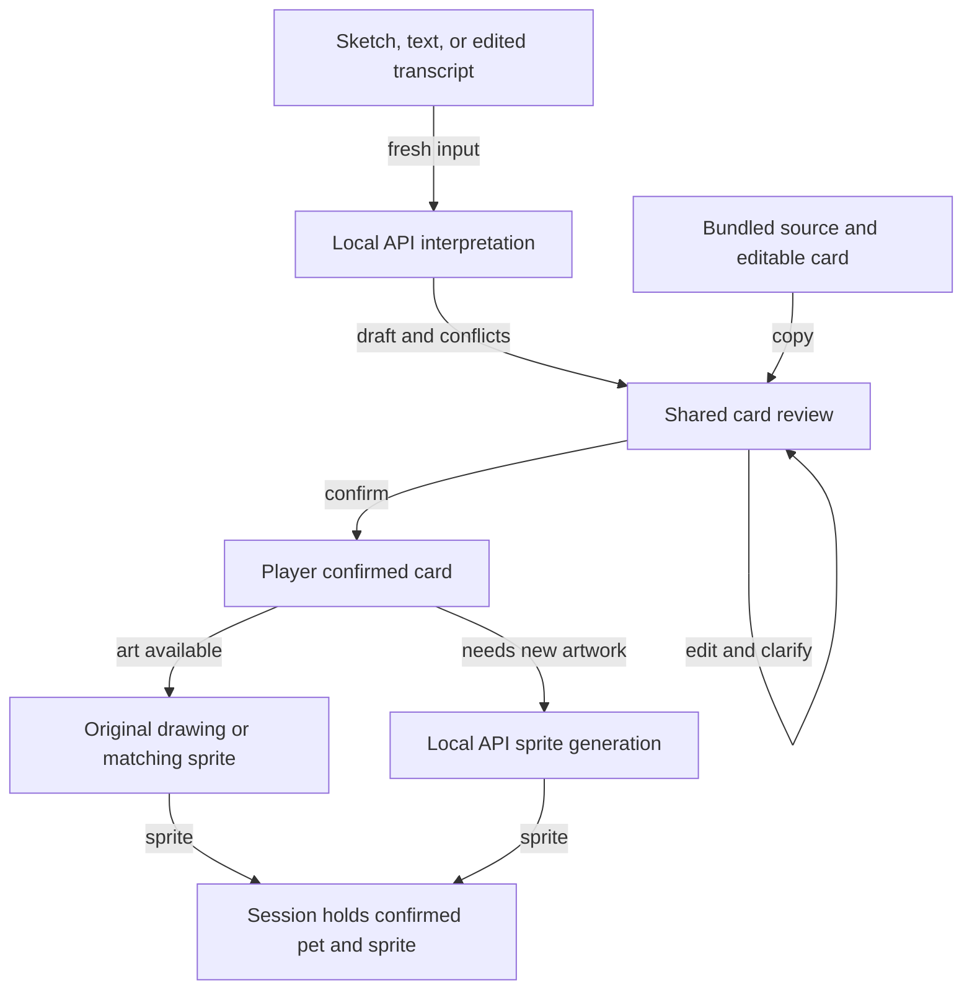
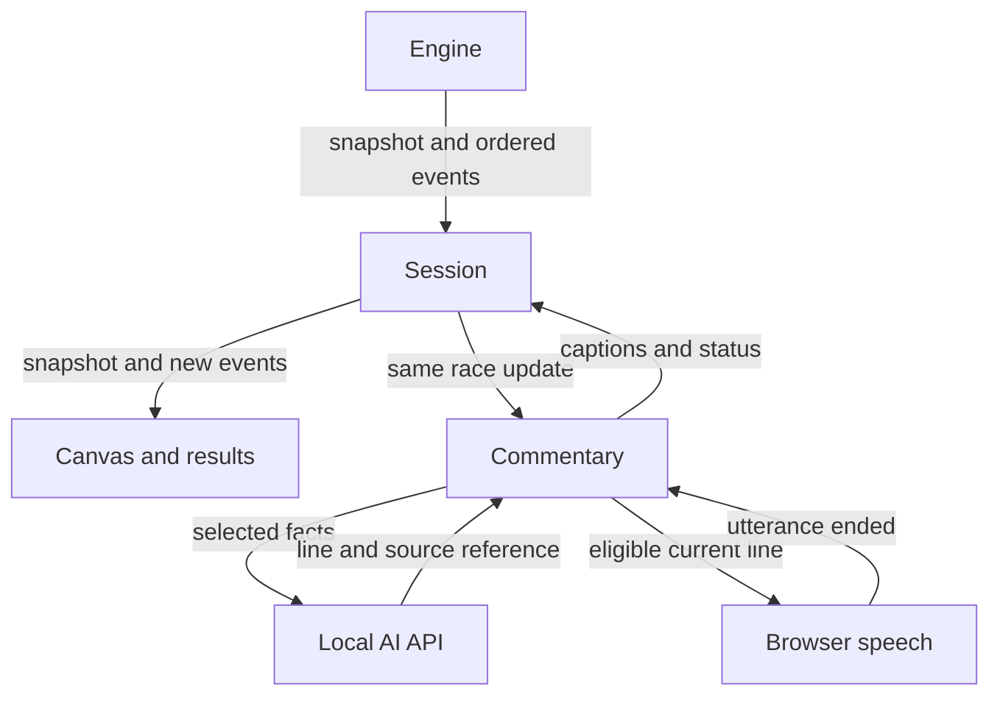

# Component dependencies and data flow

**Application Design · approved by Group 22 on November 24, 2026.** Read the matrix by row. A cell identifies a direct call made by that row’s component. Returned data and completion notifications travel back through the same interface and do not introduce another component dependency.

| Caller / callee | UI | Session | Pet | Engine | Commentary | Speech | API |
|---|---|---|---|---|---|---|---|
| UI | — | S | — | — | — | — | — |
| Session | — | — | S/A | S | S/A | — | — |
| Pet | — | — | — | — | — | — | A |
| Engine | — | — | — | — | — | — | — |
| Commentary | — | — | — | — | — | S | A |
| Speech | — | — | — | — | — | — | — |
| API | — | — | — | — | — | — | — |

**S** is a direct synchronous call. **A** is an asynchronous request. **S/A** covers both. Speech dispatch returns immediately and reports playback completion later. UI subscribes to Session for view changes. Session subscribes to Commentary for captions, sound status, and asynchronous errors. These are callbacks registered on the named interfaces.

## Creation and confirmation

Fresh creation and the bundled example meet at the same editable card. A voice recording passes through API for transcription before it becomes reviewed input. Card edits and clarification answers stay in the draft. Confirmation produces a matching card and sprite. For a pet without a drawing, an existing generated sprite is reusable only for the same appearance. Session checks the request still belongs to the current draft before accepting the pair.

## Racing and narration

The second diagram follows **data**, so the Engine-to-Session arrow is the return from Session’s synchronous engine call. Session makes the same ordered update available to Canvas and Commentary. A live request carries a specific event and its standings. A line can arrive after another pass, so Commentary checks the current snapshot before captioning and before queued speech. The renderer keeps receiving updates throughout the request. On the terminal update, Session sends the official ranking to UI and the final record to Commentary for its separate recap request.

## Integration boundaries

| Boundary | Payload and direction | How to examine it later |
|---|---|---|
| UI and devices | Pointer strokes and an explicitly requested microphone clip enter UI. UI renders positions and text, and releases microphone tracks. | Use Playwright fixtures for independent and combined inputs. Verify actual microphone capture on the demo laptop separately. |
| Session and Engine | Session supplies game time and timed inputs. Engine returns a snapshot, newly ordered events, and eventually the official result. | Drive the engine without Canvas or a network connection. For the same inputs, course and seed, compare event order and final ranking. |
| Pet or Commentary and API | Only the local server calls the hosted provider. Send the selected creation input or the relevant race facts, then return a validated result or named failure. | Substitute mock responses for all six [API operations](component-methods.md#api). Hold a response across correction, finish, replay, or restart. |
| Commentary and Speech | Offer one eligible line, receive an utterance completion, or cancel. Commentary alone decides which pending highlight remains eligible. | Use a fake voice to complete a line after mute or reset. A separate speaker check establishes whether the snack call is audible during the race. |

[Component responsibilities](components.md) · [Services](services.md) · [Design overview](application-design.md)
