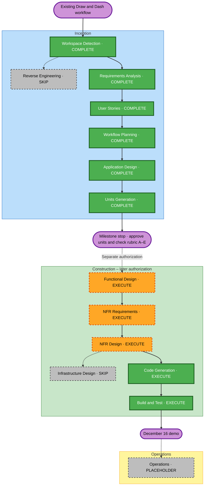

# Draw & Dash execution plan

**Status** — Group 22 approved the execution plan on November 24, 2026, and authorized Application Design. The [audit record](../../audit.md#workflow-planning--execution-plan-approved) records the team's decision.

**Milestone boundary** — Complete Application Design and Units Generation, obtain explicit team approval of the units, then stop for the November 24 milestone check. Construction is a forecast for the December 16 final project and requires separate authorization.

## Scope and impact

The project starts with one local player, two bundled opponents, and one fixed course. The player should recognize the pet they created and understand a funny loss from both the visible action and the recap. The following handoffs guide the design review. Final component names and unit boundaries belong to the next two stages.

| Player outcome | Impact the design must account for | Approved coverage |
|---|---|---|
| Create and confirm a recognizable pet | Drawing, text, and voice work alone or together. Fresh inputs and prepared examples reach the same review. The player can erase strokes, clear the canvas, edit a transcript, correct the card, and settle conflicting details. Keep the original drawing whenever supplied. Otherwise generate a static hand-drawn-style sprite after appearance confirmation. | US-01–US-05 · FR-01–FR-03 |
| Watch the race and choose when to cheer | The local engine owns movement, event order, and official ranking over an approximately 30-second race. All pets follow the same rules. A pet can have up to two sequential habits. A snack pause followed by a chase must be visible. The human can cheer once or let the race finish autonomously. | US-06–US-07, US-11 · FR-04–FR-05, NFR-01 |
| Follow the action by caption or voice | The opening and routine lines are prepared ahead of time. Matching routine events and selected live highlights produce captions. Browser speech can read a routine call when free or a live highlight while current. Muting mid-line must leave movement and captions running. | US-08–US-10 · FR-06–FR-07, NFR-02 |
| See the result, understand it, and play again | Publish the official ranking as the race ends. The AI recap draws from that race’s event log. Replay reuses the confirmed pet and artwork, restores one cheer, and drops old narration. Identify a failed required AI operation and offer restart. When device speech is unavailable, preserve captions. | US-10–US-14 · FR-08–FR-09 |

**Structure, data, and APIs.** The browser owns the drawing canvas, local simulation, controls, and speech playback. The loopback Express server validates submissions and mediates calls to OpenAI. Agree on the information passed between them, including the reviewed pet card, sprite, timestamped race events, and captions associated with a particular race. Keep session data in memory. The design needs contracts for transcription, interpretation, image generation, and commentary. It has no database migration or existing package dependency to coordinate.

**Quality constraints.** Use the approved vanilla TypeScript stack. Disclose provider processing, keep credentials server-side, stop microphone tracks after recording, validate uploads and model output, and exclude player inputs and generated content from application logs. The $20 API budget includes $5 for rehearsal and the demo. Use bundled opponents, sprite reuse, and mocked provider responses for routine checks. Vitest and fast-check cover pure rules and applicable lossless transformations. Playwright covers the browser journey. These constraints carry NFR-03 through NFR-06 into later stages.

## Risk assessment

**Overall risk is medium.** The hardest handoff is a real-time overtake call that returns after the lead has changed. An event tied to the current race gives the team a way to test exactly when that line should be dropped. A late response must also leave the official ranking untouched.

| Risk | Later verification |
|---|---|
| A pause and a chase compete, or a second cheer changes a result | Use fixed inputs and a seed where applicable. Compare event order and final ranking. Generate cases with zero through two habits and repeated cheer attempts. |
| Narration describes an old event, talks over another line, or continues on replay | Delay and reorder mock responses around an overtake, mute, finish, and restart. Check captions and speech independently. |
| A mock passes while a team-account request or laptop audio fails | Kelan verifies account access, latency, and spend during separately authorized live checks. Rehearse fresh and prepared inputs, microphone capture, sprite wait time, and audible playback on the demo laptop. |

Rollback complexity is low for local, session-only changes. Test complexity is moderate because reproducible race logic, asynchronous provider responses, and device audio need different evidence.

## Workflow visualization

Solid arrows show the planned stage order. Dotted branches identify skips, the milestone authorization boundary, and the Operations placeholder. The tables below give the same decisions in text. Construction design and generation apply per relevant unit, followed by integrated Build and Test.

## Stage decisions

The lifecycle has 14 named stages including the Operations placeholder. Across both milestones, 11 are selected for execution, two are skipped, and one is a placeholder. All six selected Inception stages are complete through Units Generation. The five selected Construction stages are prospective.

### Inception for November 24

| Stage | Decision | Reason |
|---|---|---|
| Workspace Detection | COMPLETE | The kickoff established a greenfield repository. |
| Reverse Engineering | SKIP | The repository had no application to reverse engineer. The existing workflow record remains the starting point. |
| Requirements Analysis | COMPLETE | The team approved nine functional and six quality requirements and resolved the product questions. |
| User Stories | COMPLETE | The team approved 14 journey-based stories and one casual-player persona across five creation situations. |
| Workflow Planning | COMPLETE | The team approved the stage choices and the milestone stopping point. |
| Application Design | COMPLETE | Group 22 approved the component responsibilities, methods, services, dependencies, and consolidated design. |
| Units Generation | COMPLETE | Group 22 approved the definition, dependencies, and 14-story map for the single game unit. The milestone stops here. |

### Construction forecast for December 16

| Stage | Decision | Reason |
|---|---|---|
| Functional Design | EXECUTE | For units with game or orchestration rules, settle habit conflicts, cheer timing, and narration priority using concrete event sequences. |
| NFR Requirements | EXECUTE | For affected units, turn the approved privacy, responsiveness, budget, and reproducibility constraints into checks the team can run. |
| NFR Design | EXECUTE | Describe how those units will discard obsolete responses, protect submitted content, bound API use, and reproduce race results. |
| Infrastructure Design | SKIP | One laptop runs the browser and a loopback Express server. The technical environment already defines hosting, credentials, and the provider boundary. |
| Code Generation | EXECUTE | Use the approved per-unit plans for implementation and tests, with mocks for routine work. |
| Build and Test | EXECUTE | Integrate the units, run the browser journeys, and rehearse a complete round on the demo laptop within the reserved budget. |

### Operations

| Stage | Decision | Reason |
|---|---|---|
| Operations | PLACEHOLDER | AI-DLC v1.0.1 reserves this phase for future work. The course requires Inception and, for the final project, Construction. |

## Deliverables, timing, and review gates

| Checkpoint | Deliverable and approval |
|---|---|
| Workflow Planning | Review this execution plan, including the diagram, stage decisions, and milestone boundary. Team approval opens Application Design. |
| Application Design | Use a checklist and resolve genuine design questions in `application-design-plan.md`. Review `components.md`, `component-methods.md`, `services.md`, `component-dependency.md`, and the consolidated `application-design.md`. Explicit approval opens Units Generation. |
| Units Generation | Approve `unit-of-work-plan.md` before generation. Then review `unit-of-work.md` (including greenfield code organization), `unit-of-work-dependency.md`, and `unit-of-work-story-map.md`. Check that every US-01–US-14 story has an owner and each cross-unit handoff has a dependency. |
| Milestone close | After explicit approval of the units, stop before Construction. Check the repository against rubric A–E for product proposal and scope, input documents, process and record, Inception artifacts, and clarity. Record the findings and any gaps. |

**Estimated timing.** Allow roughly two to four hours of shared design, decomposition, and review time for the remaining Inception work on November 24, depending on revisions and team availability. The course deadline is 11:59 p.m. Eastern. The following three weeks to December 16 are the available final-project window. A per-unit schedule can be estimated once the team has approved the decomposition.

**Depth and deferred decisions.** Use standard detail for the remaining Inception artifacts, with particular care at the pet-confirmation and race-event interfaces. Functional Design can settle habit tie-breaks, effect sizes and durations, cheer behavior during a pause, and exact highlight priority and cutoff rules. NFR work and rehearsal can settle recording limits, acceptable waits, and device voice selection. Actual latency, charges, account access, and any switch of commentary model depend on live evidence. Extra courses and same-device multiplayer remain optional after the core round. The AI race director and persistent pet care stay outside the MVP.

**Extension scope.** Resiliency Baseline and Security Baseline are off. The approved failure behavior and security basics still apply. Property-Based Testing is partial for game calculations and data transformations. PBT-02, PBT-03, PBT-07, PBT-08, and PBT-09 apply at their designated Construction stages. Workflow Planning has no implementation-level extension checks.

## Source documents

[README](../../../README.md) · [Vision](../../../vision.md) · [Technical environment](../../../technical-environment.md) · [Approved requirements](../requirements/requirements.md) · [Clarification record](../requirements/requirement-verification-questions.md) · [Approved stories](../user-stories/stories.md) · [Approved persona](../user-stories/personas.md) · [Workflow state](../../aidlc-state.md) · [Audit record](../../audit.md)
